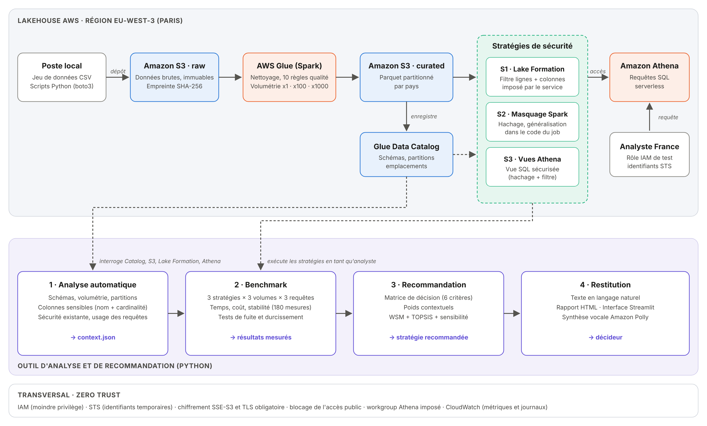

# Lakehouse Security Advisor

Outil d'analyse et de recommandation automatisée pour la mise en place de mécanismes de **sécurité granulaire** dans une architecture **Lakehouse Spark sur AWS**.

Projet réalisé dans le cadre du mémoire de Master en Informatique, option Data Engineering (Dakar Institute of Technology, 2025-2026).

---

## Contexte

Les architectures Lakehouse centralisent de grands volumes de données, dont des données sensibles. Plusieurs mécanismes permettent de les protéger sur AWS, mais leur choix repose souvent sur l'intuition. Cet outil **objective ce choix** : il analyse automatiquement le Lakehouse, compare trois stratégies de sécurité par des mesures réelles, puis recommande la plus adaptée au contexte.

Stratégies comparées :
- **AWS Lake Formation** : filtres de lignes et de colonnes imposés par le service ;
- **Masquage applicatif Spark** : hachage, généralisation et filtrage dans le code ;
- **Vues Athena sécurisées** : règle de protection appliquée par une vue SQL.

## Fonctionnalités

1. **Analyse automatique** du Lakehouse : schémas, volumétrie, colonnes sensibles (nom et cardinalité), configuration Lake Formation, historique des requêtes.
2. **Benchmark** des trois stratégies sur trois volumes (10⁴, 10⁶ et 10⁷ lignes) : temps de réponse, coût, stabilité et tests de fuite.
3. **Moteur de recommandation** multicritère : score pondéré (WSM) et TOPSIS, avec pondération contextuelle et analyse de sensibilité.
4. **Restitution** : recommandation en langage naturel, rapport HTML, interface Streamlit et synthèse vocale (Amazon Polly).

## Architecture



Services utilisés : Amazon S3, AWS Glue (Spark), Glue Data Catalog, Amazon Athena, AWS Lake Formation, AWS IAM / STS, Amazon CloudWatch, Amazon Polly.

## Structure du projet

```
├── config.py        Configuration centrale (région, ressources)
├── infra/           Création de l'infrastructure (S3, IAM, Glue, Athena)
├── etl/             Ingestion et nettoyage des données (Spark)
├── analyzer/        Analyse automatique du contexte
├── strategies/      Mise en place des trois stratégies de sécurité
├── benchmark/       Mesures de performance et tests de fuite
├── recommender/     Matrice de décision, WSM, TOPSIS, sensibilité
├── app/             Recommandation, rapport HTML, Streamlit, Polly
└── docs/            Schémas et captures
```

## Prérequis

- Python 3.10 ou plus
- Un compte AWS (région eu-west-3 par défaut) et l'AWS CLI configurée (`aws configure`)
- Droits sur S3, Glue, Athena, Lake Formation, IAM et Polly
- Jeu de données : [Bank Customer Churn Prediction](https://www.kaggle.com/datasets/gauravtopre/bank-customer-churn-dataset), à placer dans `data/Bank_Customer_Churn_Prediction.csv`

## Installation

```bash
git clone https://github.com/<votre-compte>/lakehouse-security-advisor.git
cd lakehouse-security-advisor
python -m venv .venv
.venv\Scripts\activate          # Windows  (Linux/Mac : source .venv/bin/activate)
pip install -r requirements.txt
```

## Utilisation

Les scripts s'exécutent dans l'ordre suivant, depuis la racine du projet :

```bash
# 1. Infrastructure et données
python infra/create_buckets.py
python infra/setup_glue.py
python etl/upload_raw.py
python etl/run_etl.py 1 100 1000
python infra/setup_athena.py

# 2. Analyse automatique
python analyzer/catalog_scanner.py
python analyzer/sensitive_detector.py
python analyzer/lf_inspector.py
python analyzer/query_patterns.py
python analyzer/build_context.py

# 3. Stratégies et benchmark
python infra/create_analyst_role.py
python strategies/s3_secure_views.py
python strategies/s1_lake_formation.py
python strategies/s2_run_spark.py
python benchmark/run_benchmark.py
python benchmark/summarize.py
python benchmark/security_tests.py
python infra/harden_analyst.py
python benchmark/security_tests.py hardened
python infra/harden_analyst.py restore

# 4. Recommandation et restitution
python recommender/build_matrix.py
python recommender/wsm.py
python recommender/topsis.py
python recommender/sensitivity.py
python app/narrative.py
python app/report_html.py --open
python app/voice_polly.py
streamlit run app/streamlit_app.py
```

## Principaux résultats

- La sécurité granulaire n'entraîne pas de dégradation significative des performances aux volumes testés.
- Seul Lake Formation impose réellement le contrôle d'accès (4 tentatives de fuite bloquées sur 4) ; les vues et le masquage Spark restent contournables.
- Les deux modèles recommandent Lake Formation dans le contexte étudié, avec un classement identique (Spearman = 1).
- L'analyse de sensibilité montre que le choix dépend de la priorité donnée à la sécurité et du volume de données.

## Auteur

**Megane Kasongo Makaba**, Master Data Engineering, Dakar Institute of Technology
